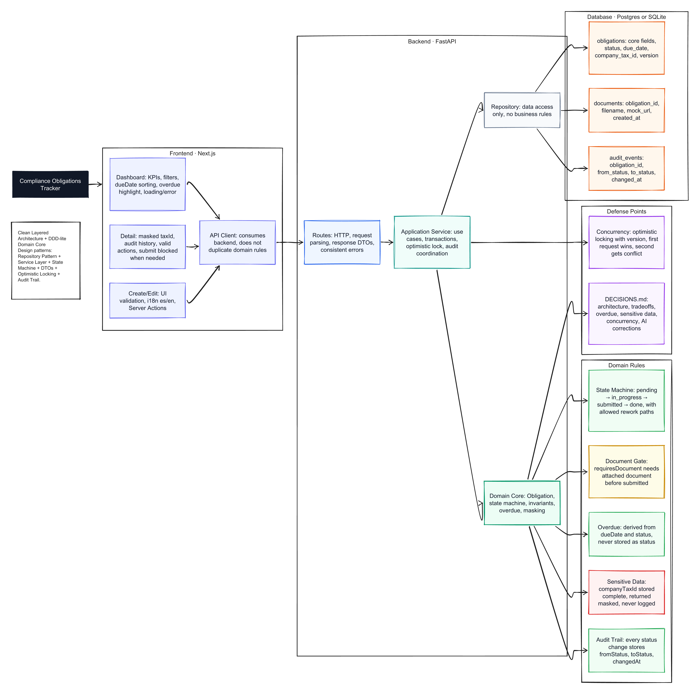
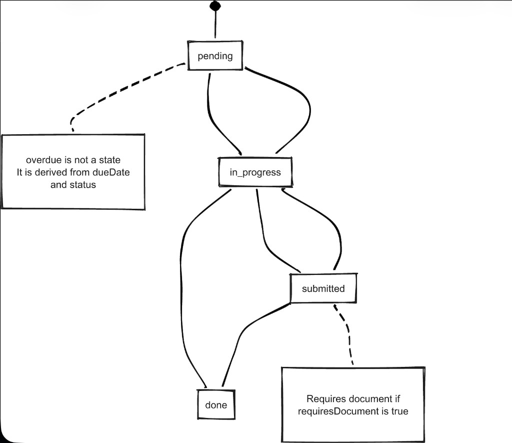
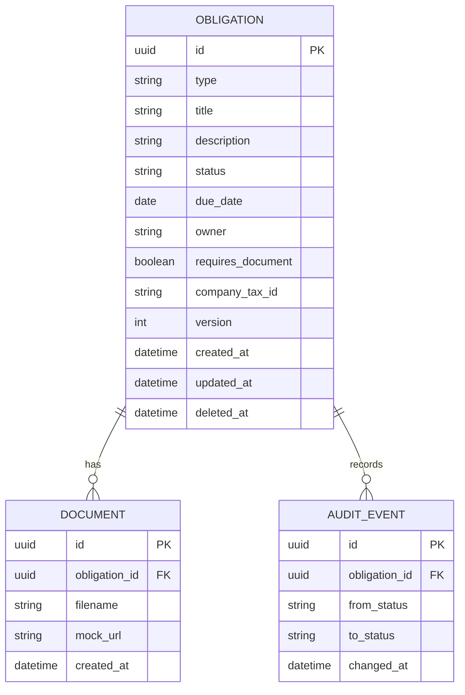

# Compliance Obligations Tracker

Seguimiento de obligaciones de compliance de una empresa: qué presentar, cuándo vence, en qué estado y con qué documentación. Backend con reglas de dominio aisladas (máquina de estados, invariante doc-gated, overdue derivado, audit trail, dato sensible enmascarado, concurrencia con optimistic lock) y frontend Next.js con i18n es/en.

Ayuda a las empresas a gestionar sus obligaciones legales y regulatorias, realizar el seguimiento de los vencimientos, asignar responsabilidades, gestionar la documentación de respaldo y mantener un historial auditable de las actividades de cumplimiento normativo.

## How to run

**Requisitos.** Python 3.11 o posterior, Node.js 22 (desde 22.13) o 24 con npm, y Docker en ejecución con Docker Compose.

### Backend y base de datos

Desde la raíz del repositorio, ejecutá estos comandos en una terminal.

```bash
cd backend
python3 -m venv .venv
.venv/bin/python -m pip install -e ".[dev]"
docker compose up -d --wait db
.venv/bin/uvicorn src.main:app --reload
```

El backend se conecta al PostgreSQL local de Docker Compose y crea las tablas al arrancar. Para usar otra base de datos, configurá `DATABASE_URL` antes de iniciar Uvicorn. Podés verificar el servicio en [`/health`](http://localhost:8000/health) y consultar la API en [Swagger UI](http://localhost:8000/docs).

Si `pyexpat` falla en macOS con Python de Homebrew, ejecutá `export DYLD_LIBRARY_PATH="$(brew --prefix expat)/lib:${DYLD_LIBRARY_PATH:-}"` antes de volver a intentar el comando que falló.

### Frontend

Dejá el backend en ejecución y abrí otra terminal en la raíz del repositorio.

```bash
cd frontend
npm ci
cp .env.local.example .env.local
npm run dev
```

Abrí [http://localhost:3000](http://localhost:3000). La app redirige a `/es` y se conecta a la API en `http://localhost:8000`. Si la API corre en otra dirección, ajustá `NEXT_PUBLIC_API_URL` en `.env.local`.

## Stack

- **Backend:** FastAPI + Pydantic + SQLAlchemy + PostgreSQL (SQLite en tests). Capas: `domain` → `application` → `infrastructure` + `interfaces/http`.
- **Frontend:** Next.js (App Router) + React + TS strict + Tailwind. Server Components por defecto, Server Actions para mutaciones. i18n propio (sin librería).

## Estructura

```
backend/src/
  domain/            reglas de negocio puras (sin HTTP, sin DB)
    entities/        Obligation, Document, AuditEvent
    value_objects/   Status, ObligationType, CompanyTaxId
    services/        state machine, overdue, tax id masking
    errors/          errores de dominio
  application/       casos de uso + ports (interfaces de repos) + DTOs
  infrastructure/    modelos SQLAlchemy, repos Postgres, session, logging
  interfaces/http/   rutas FastAPI, schemas, mappers, modelo de error
  config/            settings + logging
  main.py            entrypoint (create_app)

frontend/src/
  app/[locale]/            páginas (dashboard, detalle, crear, editar) + loading/error
  features/obligations/    api client, server actions, formulario
  components/              primitivas UI
  i18n/                    diccionarios es/en + provider
  lib/                     http-client + tipos
  middleware.ts            redirección de locale
```

## Diagramas

### Arquitectura (capas + patrones)



Fuente editable: [`docs/diagrams/01-architecture.excalidraw`](docs/diagrams/01-architecture.excalidraw)

### Máquina de estados

<p align="center">
  
</p>

Fuente editable: [`docs/diagrams/02-state-machine.excalidraw`](docs/diagrams/02-state-machine.excalidraw)

`overdue` no es un estado persistido: se deriva de `due_date` y `status` (ver reglas de dominio).

## Modelo de datos (3 tablas)

| Tabla | Campos | Relación |
|-------|--------|----------|
| `obligations` | `id` · `type` · `title` · `description` · `status` · `due_date` · `owner` · `requires_document` · `company_tax_id` · `version` · `created_at` · `updated_at` · `deleted_at` | — |
| `documents` | `id` · `obligation_id` (FK) · `filename` · `mock_url` · `created_at` | una obligación **tiene** documentos |
| `audit_events` | `id` · `obligation_id` (FK) · `from_status` · `to_status` · `changed_at` | una obligación **registra** eventos |

`company_tax_id` se guarda completo, se expone enmascarado (`••••6789`) y nunca se loguea. Al hacer soft delete se marca `deleted_at` y se anonimiza `company_tax_id`, preservando el audit trail.



## Reglas de dominio (dónde viven)

| Regla | Ubicación |
|-------|-----------|
| Máquina de estados (`pending → in_progress → submitted → done` + rework/reopen) | `domain/value_objects/status.py` + `domain/services/state_machine.py` |
| Invariante doc-gated (no `submitted` sin documento si `requires_document`) | `domain/services/state_machine.py` |
| Overdue derivado (no es un estado guardado) | `domain/services/overdue.py` |
| Enmascarado del tax id | `domain/value_objects/company_tax_id.py` + `domain/services/tax_id_masking.py` |
| Audit trail (de→a + timestamp) | `application/use_cases/change_status.py` |
| Concurrencia (optimistic lock por `version`) | `infrastructure/repositories/postgres_obligation_repository.py` |

Ninguna regla vive en el handler HTTP: las rutas solo traducen HTTP ↔ use case ↔ DTO.

## API

| Método | Ruta | Descripción |
|--------|------|-------------|
| `GET` | `/health` | healthcheck |
| `GET` | `/dashboard` | KPIs (total, por estado, vencidas, próximas) |
| `GET` | `/obligations?status=` | listado (filtro opcional por estado) |
| `POST` | `/obligations` | crear |
| `GET` | `/obligations/{id}` | detalle (campos + audit + transiciones válidas + can_submit) |
| `PUT` | `/obligations/{id}` | editar (requiere `version`) |
| `DELETE` | `/obligations/{id}` | soft delete |
| `PATCH` | `/obligations/{id}/status` | cambiar estado (requiere `version`) |
| `POST` | `/obligations/{id}/documents` | adjuntar documento (mock) |

Modelo de error consistente: `{"error": {"code": "...", "message": "..."}}`. Códigos: `not_found` (404), `conflict` (409), `invalid_transition` / `document_required` / `invalid_company_tax_id` / `validation_error` (422). Docs OpenAPI en `/docs`.

## Tests

```bash
# Backend (unit de dominio + integración HTTP sobre SQLite in-memory)
cd backend
export DYLD_LIBRARY_PATH="/opt/homebrew/opt/expat/lib:${DYLD_LIBRARY_PATH:-}"
.venv/bin/pytest                           # 24 passed

# Frontend (Vitest + Testing Library)
cd frontend
npm test                                   # flujo del formulario
```

Los tests de backend no necesitan Postgres levantado (usan SQLite in-memory con `StaticPool`).

## Qué dejé afuera (no me dio tiempo :p)

- Autenticación, roles y multi-tenant.
- CI (lint + test en pipeline), deploy a producción.
- Upload real de documentos (solo mock).
- Paginación, búsqueda y recordatorios.
- Migraciones con Alembic (`create_all()` al arrancar).
- Cobertura exhaustiva; tests de comportamiento clave nómás.

Detalle de arquitectura y trade-offs en `DECISIONS.md`.

## Próximamente

- CI en GitHub Actions (pytest + vitest + lint).
- Deploy (backend + front) y seed de datos demo.
- Paginación en listado y filtros extra (por tipo).
- Auth simple (API key o sesión básica).
- Confirmación antes de borrar; mensajes de error i18n en toda la UI (hoy parcialmente inline).

## Decisiones

- **`DECISIONS.md`**: documento para la defensa (arquitectura, API, overdue, concurrencia, dato sensible, uso de IA).
- `decisiones-tecnicas.md`: resumen breve de alto nivel.
- `registro-decisiones.md`: log de auditoría con cada decisión puntual durante el desarrollo.

## Licencia

Este proyecto se distribuye bajo la licencia MIT.
